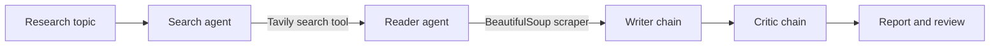

# ResearchLab — Multi-Agent Research Assistant

ResearchLab is a web-based multi-agent research assistant. Give it a topic and a coordinated workflow searches the web, reads a relevant page, writes a structured report, and asks a critic agent to review the result.

The project combines **LangChain**, **Google Gemini**, **Tavily**, **BeautifulSoup**, **FastAPI**, and a lightweight HTML/CSS/JavaScript frontend.

## Table of contents

- [What it does](#what-it-does)
- [How the agents work together](#how-the-agents-work-together)
- [Technology stack](#technology-stack)
- [Requirements](#requirements)
- [Setup](#setup)
- [Configuration](#configuration)
- [Run the application](#run-the-application)
- [API](#api)
- [Project structure](#project-structure)
- [Data and privacy](#data-and-privacy)
- [Current limitations](#current-limitations)
- [Contributing](#contributing)
- [License](#license)

## What it does

- Searches the web for recent, relevant information with Tavily.
- Selects a relevant result and extracts readable page text with Requests and BeautifulSoup.
- Uses Google Gemini to turn gathered material into a structured report.
- Runs a separate critic step that evaluates the report and returns feedback.
- Displays the report, search output, extracted page content, and critic feedback in the browser.
- Saves research history, saved-report IDs, and custom collection names in browser `localStorage`.
- Provides a command-line entry point for running the research workflow without the web interface.

## How the agents work together



1. **Search agent** uses the `web_search` tool to find up to five results and return titles, URLs, and snippets.
2. **Reader agent** reviews the search results, chooses a relevant URL, and calls `scrap_url` to extract page text.
3. **Writer chain** combines the topic, search results, and extracted text, then drafts an introduction, key findings, conclusion, and sources.
4. **Critic chain** reviews the draft and returns a score, strengths, improvement areas, and a short verdict.

The current workflow runs sequentially. The frontend shows estimated progress stages; it does not receive live agent events from the backend.

## Technology stack

| Area | Technology |
| --- | --- |
| Language | Python 3.13+ |
| Agent orchestration | LangChain agents and chains |
| Language model | Google Gemini via `langchain-google-genai` |
| Web search | Tavily Search API (`tavily-python`) |
| Page extraction | Requests and BeautifulSoup (`beautifulsoup4`) |
| HTML parser | Python's built-in `html.parser` |
| API server | FastAPI and Uvicorn |
| Request validation | Pydantic |
| Frontend | HTML, CSS, and vanilla JavaScript |
| Browser-side storage | `localStorage` |

## Requirements

- Python 3.13 or newer
- A Google Gemini API key
- A Tavily API key
- Internet access for model calls, search, and page retrieval

## Setup

### 1. Clone the repository

```bash
git clone <your-repository-url>
cd MultiAgent
```

### 2. Create and activate a virtual environment

Windows PowerShell:

```powershell
py -3.13 -m venv .venv
.venv\Scripts\Activate.ps1
```

macOS or Linux:

```bash
python3.13 -m venv .venv
source .venv/bin/activate
```

### 3. Install dependencies

With pip:

```bash
python -m pip install --upgrade pip
pip install -r requirements.txt
```

Or, if you use [uv](https://docs.astral.sh/uv/):

```bash
uv sync
```

## Configuration

Create a `.env` file in the project root. Add your own keys; never commit this file.

```dotenv
GOOGLE_API_KEY=your_google_gemini_api_key
TAVILY_API_KEY=your_tavily_api_key
```

The Gemini integration also supports `GEMINI_API_KEY` in environments where that is the configured Google GenAI credential name. Keep API keys on the backend. Do not put them in frontend JavaScript or publish them in screenshots or logs.

The model is configured in `agents.py` as `gemini-3.5-flash-lite`. Change that setting there if you want to use a different model available to your Google AI account.

## Run the application

### Web application

From the project root, start the FastAPI development server:

```bash
uvicorn main:app --reload
```

Open [http://127.0.0.1:8000](http://127.0.0.1:8000). The frontend is served by FastAPI, and research requests are sent to `POST /api/research`.

### Command-line workflow

Run the pipeline directly and enter a topic when prompted:

```bash
python pipeline.py
```

The command-line workflow prints the search results, extracted page text, generated report, and critic review to the terminal.

## API

### `POST /api/research`

Request JSON:

```json
{
  "topic": "How are AI agents used in healthcare?"
}
```

The topic must contain 3–500 characters. A successful response contains:

```json
{
  "topic": "How are AI agents used in healthcare?",
  "search_result": "...",
  "scraped_content": "...",
  "report": "...",
  "feedback": "..."
}
```

Example using curl:

```bash
curl -X POST http://127.0.0.1:8000/api/research \
  -H "Content-Type: application/json" \
  -d '{"topic":"How are AI agents used in healthcare?"}'
```

## Project structure

```text
.
├── agents.py          # Gemini setup, search/reader agents, writer and critic chains
├── main.py            # FastAPI app, frontend serving, and research API endpoint
├── pipeline.py        # Sequential multi-agent research workflow
├── tools.py           # Tavily web search and BeautifulSoup page extraction tools
├── static/
│   ├── index.html     # ResearchLab interface
│   ├── script.js      # Navigation, API calls, reports, and browser storage
│   ├── style.css      # Responsive layout and component styling
│   └── favicon.svg    # Browser tab icon
├── .env               # Local API keys (create this; do not commit)
├── requirements.txt   # pip dependencies
└── pyproject.toml     # Project metadata and uv dependencies
```

## Data and privacy

- Gemini and Tavily API calls are made by the Python backend. Their API keys should remain in the backend environment.
- Research history and saved-report selections are stored in the current browser's local storage. They are not currently stored in a server-side database or synchronized across browsers.
- The reader fetches a URL selected by the agent. Scraped content may be incomplete or unavailable depending on the target site.

## Current limitations

- Research depends on valid Google Gemini and Tavily credentials and network access.
- The reader processes one selected URL and limits extracted text to a short excerpt.
- Agent progress in the UI is estimated; the API currently returns the completed workflow as one response.
- Browser history is local to the browser profile and can be cleared by the user or browser settings.
- The project is an educational prototype. Generated reports and sources should be checked before relying on them.

## Contributing

Contributions and suggestions are welcome. For a change, create a branch, make a focused update, and open a pull request with a clear summary and steps to reproduce or review it. Do not include `.env`, API keys, virtual environments, or generated cache files.
